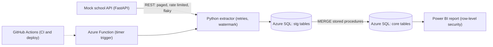

# Campus Data Hub

A learning project: a small school data platform built the way a school's enterprise applications team works. You build a mock school API, a Python pipeline that pulls from it, an Azure SQL database loaded with T-SQL, CI with GitHub Actions, a nightly Azure Function, and a Power BI report.

Everything uses fake data. No real student or personal information goes in here.

## How it fits together

## Milestones

| # | Milestone | Job skill it proves | Time |
| --- | --- | --- | --- |
| M0 | [Setup](docs/milestones/M0-setup.md) | Git, environments, Azure cost safety | 1 evening |
| M1 | [Mock school API](docs/milestones/M1-mock-api.md) | REST design, pagination, auth, status codes | 2 to 3 evenings |
| M2 | [Extractor](docs/milestones/M2-extractor.md) | Consuming REST, retries, incremental loads, pytest | 2 evenings |
| M3 | [Azure SQL and T-SQL](docs/milestones/M3-database.md) | T-SQL, MERGE, stored procedures, window functions | 2 evenings |
| M4 | [Load and log](docs/milestones/M4-load.md) | Idempotent pipelines, run logging | 1 to 2 evenings |
| M5 | [CI and code review](docs/milestones/M5-ci-review.md) | GitHub Actions, pull requests, branch protection | 1 evening |
| M6 | [Azure Function](docs/milestones/M6-azure-function.md) | Azure Functions, secrets, CD | 2 evenings |
| M7 | [Power BI report](docs/milestones/M7-power-bi.md) | Reporting, DAX, row-level security | 1 to 2 evenings |
| M8 | [Stretch: Data Factory](docs/milestones/M8-stretch-adf.md) | Azure Data Factory pipelines | optional |
| M9 | [Write-up](docs/milestones/M9-write-up.md) | Documentation, change management, interview story | 1 evening |

## How to work

- One branch and one pull request per milestone (from M5 on, CI must pass before merging).
- Each milestone guide has a goal, what you'll learn, what to build, hints, and a "done when" checklist.
- You write the code. Ask Claude for hints, explanations, and PR reviews. The rules for that are in `CLAUDE.md`.
- Keep a short `docs/notes.md` of what confused you and how you solved it. Those notes become interview stories.

## Cost safety

- Create a $5 budget alert in Azure Cost Management before you create anything else.
- Use the Azure SQL Database free offer and a Consumption plan Function App.
- Put everything in one resource group (`rg-campus-data-hub`) so you can delete it all in one step when you're done.
